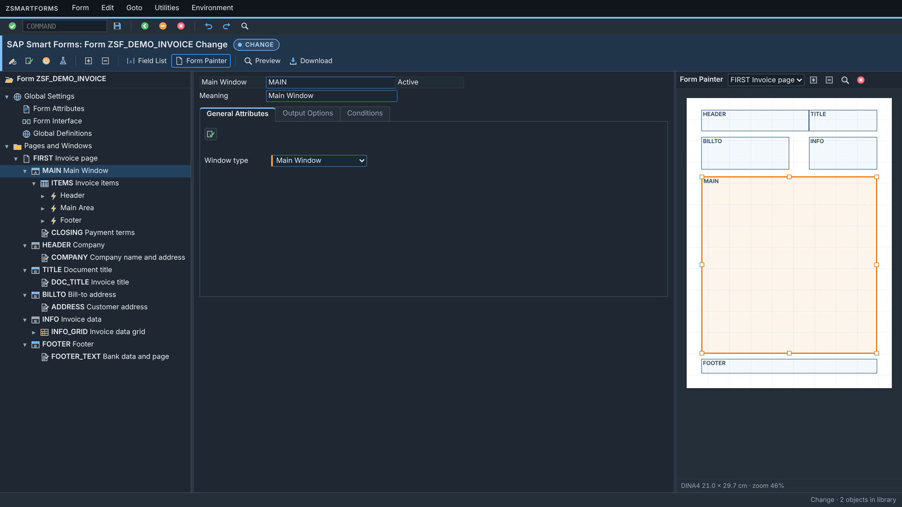
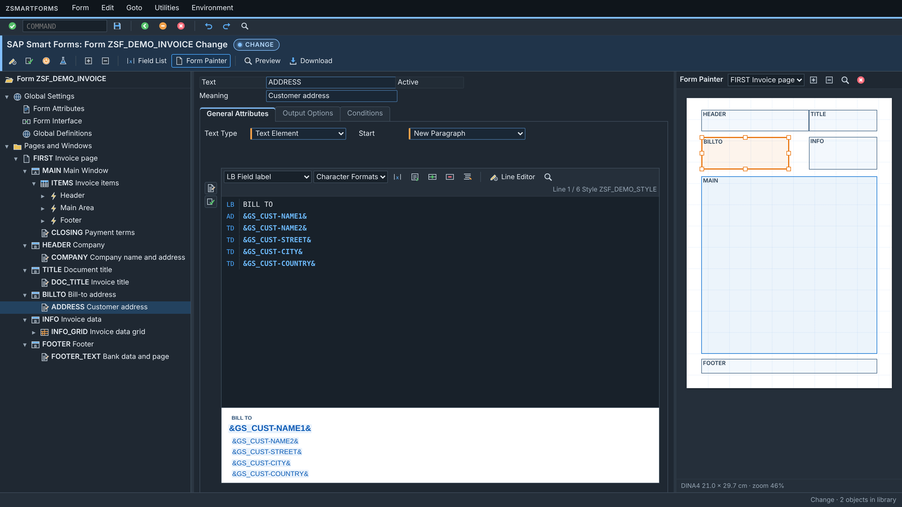
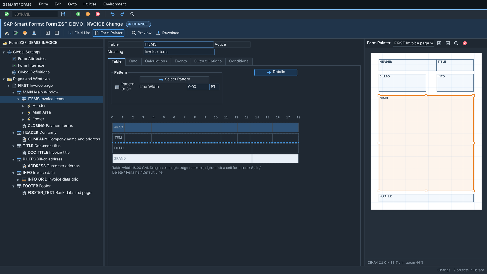

# ZSMARTFORMS: the SAP Smart Forms Form Builder in the browser

A 1:1 web replacement for transaction **SMARTFORMS** / **SMARTSTYLES**, served by your SAP system.
Same screens, same nodes, same logic, but without the embedded Word editor and the download/upload dialogs.
It saves, checks, activates and generates forms directly in SAP.



| Text editor (no MS Word) | Table Painter |
|---|---|
|  |  |

## Features

- **Form Builder**
  - Full navigation tree: pages, windows, texts, tables, templates, loops, conditions, program lines, commands, addresses and graphics.
  - Create, cut, copy and paste nodes, plus drag & drop.
- **Original screens**
  - About 100 SAPLSTXB dynpro screens are rebuilt field by field.
  - They follow the same PBO/PAI rules and the same context menus as SMARTFORMS.
- **Form Painter**
  - Move and resize windows on the page.
- **Table Painter**
  - Line types, cells and patterns.
  - Shading and frames are shown the way SAP prints them.
- **Text editor**
  - PC editor with a live preview, and a line editor with a format column and 132-character lines.
  - Field insertion and the style's paragraph and character formats.
- **Smart Styles**
  - Header data, paragraph formats, character formats, tab stops, outline and underline.
- **Global Definitions**
  - Global data, types, field symbols, initialization and form routines.
  - Includes an ABAP editor with syntax highlighting.
- **Local check**
  - Runs before activation.
  - Includes SAP rules, for example *"Boxes/Shadings are not allowed within a table"*.
- **Other tools**
  - Static layout preview, undo/redo, light and dark theme.
  - Distinct colours for Change and Display mode.
- **Lossless XML round trip**
  - Reads and writes the original Smart Forms XML, the same format as *Utilities → Download/Upload*.
  - Untouched parts stay byte-identical.

### Connected to SAP (ICF service)

- Open any form, text module or style straight from the system, with F4 over the SAP repository.
- **Save** stores the object inactive. **Activate** checks it and generates the function module, with no SAP GUI dialogs.
- **Delete**, **Copy** and **Rename** work directly in SAP.
- Transport handling: objects in `$TMP` need nothing, transportable objects use the request entered in *Settings → SAP Connection*.
- **Test (F8)** shows the generated function module.

Without a backend the page also works offline as a standalone HTML file. In that mode you upload the XML files or a ZIP and download the changed objects for *SMARTFORMS → Utilities → Upload*.

## Architecture

```
SAP GUI ── transaction ZSMARTFORMS (report) ── opens the browser
                                                   │
Browser ◄── GET /sap/bc/zsmartforms ────────── ZCL_SMARTFORMS_HTTP (ICF handler)
   │                                              │  serves the page from SMW0 (ZSMARTFORMS_HTML)
   └── /sap/bc/zsmartforms/api/... (JSON/XML) ──► ZCL_SMARTFORMS_IO
                                                      CL_SSF_FB_SMART_FORM (xml_upload / check / store)
                                                      FB_GENERATE_FORM, SSF_SAVE_STYLE, SSF_ACTIVATE_STYLE,
                                                      RS_CORR_INSERT (no correction dialogs)
```

| API | Purpose |
|---|---|
| `GET  /api/list?type=SF\|TM\|SS&search=` | forms, text modules and styles (JSON) |
| `GET  /api/form/NAME` | form / text module XML |
| `PUT  /api/form/NAME?transport=&devclass=&activate=X` | save (+ check, activate, generate) |
| `GET  /api/form/NAME/fm` | generated function module |
| `GET/PUT /api/style/NAME` | Smart Style XML |
| `DELETE /api/form/NAME`, `/api/style/NAME` | delete in SAP |

Writing requests must send the header `X-Requested-With: ZSMARTFORMS` (CSRF protection). Authentication is the normal SAP logon of the ICF service.

## Installation

Tested on SAP_BASIS 7.40 SP10 (ECC). The tool itself can live in the local package `$TMP`.

1. **SE24**: create `ZCL_SMARTFORMS_IO` from [`abap/zcl_smartforms_io.abap`](abap/zcl_smartforms_io.abap) using the source-code based editor, then activate it.
2. **SE24**: create `ZCL_SMARTFORMS_HTTP` from [`abap/zcl_smartforms_http.abap`](abap/zcl_smartforms_http.abap), then activate it.
3. **SE38**: create the report `ZSMARTFORMS` from [`abap/zsmartforms.abap`](abap/zsmartforms.abap).
4. **SE93**: create transaction `ZSMARTFORMS` as a report transaction (program `ZSMARTFORMS`, screen 1000, SAP GUI for Windows).
5. **SMW0**: under *Binary data for WebRFC applications*, create object `ZSMARTFORMS_HTML` and import [`dist/zsmartforms_sap.html`](dist/zsmartforms_sap.html) with MIME type `text/html`.
6. **SICF**: under `default_host/sap/bc`, create the service `zsmartforms` with handler `ZCL_SMARTFORMS_HTTP`, then activate it.
7. Run `/nZSMARTFORMS`. The editor opens in your default browser, logged on in the current client and language.

To update the editor later, only re-import `dist/zsmartforms_sap.html` in SMW0.

### Try it with the demo

[`demo/`](demo) contains a complete invoice:

- **`ZSF_DEMO_INVOICE`**: header, bill-to window, data grid template, item table with totals, footer and page counter.
- **`ZSF_DEMO_STYLE`**: the matching Smart Style.

The demo data is filled in *Global Definitions → Initialization*, so the form runs with **F8** without a print program.

1. Click **Upload** and select both files.
2. Open the style, then **Change** and **Activate**.
3. Open the form, then **Change**, **Activate** and **F8**.

### Bulk export (optional)

[`abap/zsf_export_all.abap`](abap/zsf_export_all.abap) exports all customer forms, text modules and styles into one ZIP. The XML is byte-identical to *Utilities → Download*. You can load the ZIP into the offline editor.

## Building from source

```bash
python3 build.py      # writes dist/zsmartforms.html and dist/zsmartforms_sap.html
```

There are no dependencies and no bundler. `build.py` concatenates `src/*.js` and `src/style.css`, and embeds the screen definitions (`data/screens.json`), the XML element order (`data/order2.json`) and the demo objects.

| File | Content |
|---|---|
| `src/core.js` | XML helpers, units, undo journal |
| `src/model.js` | form / style object model, node creation, tree operations |
| `src/dynpro.js` | renders SAP screens (fields, table controls, tabstrips, F4) |
| `src/bindings.js` | field logic per screen (PBO/PAI) |
| `src/formbuilder.js` | Form Builder: tree, painters, node screens |
| `src/stylebuilder.js` | Smart Styles |
| `src/texteditor.js`, `src/abapeditor.js` | text and ABAP editors |
| `src/check.js`, `src/preview.js` | local check, layout preview |
| `src/app.js` | shell, menus, library, SAP connection |

## Known limitations

- **Print preview**: the preview is static (layout only). Use **Test (F8)** for the real output.
- **Function module parameters**: the parameter names of `FB_DELETE_FORM` / `SSF_DELETE_STYLE` and the style save path are not verified on every release. Errors are reported with the include and line number.
- **Graphics**: graphic content (SE78) is referenced by name and not displayed.

## License

[MIT](LICENSE)

Built with AI assistance. The idea, the requirements and the testing against a real SAP system came from a developer who really didn't want to open the Word editor one more time.
